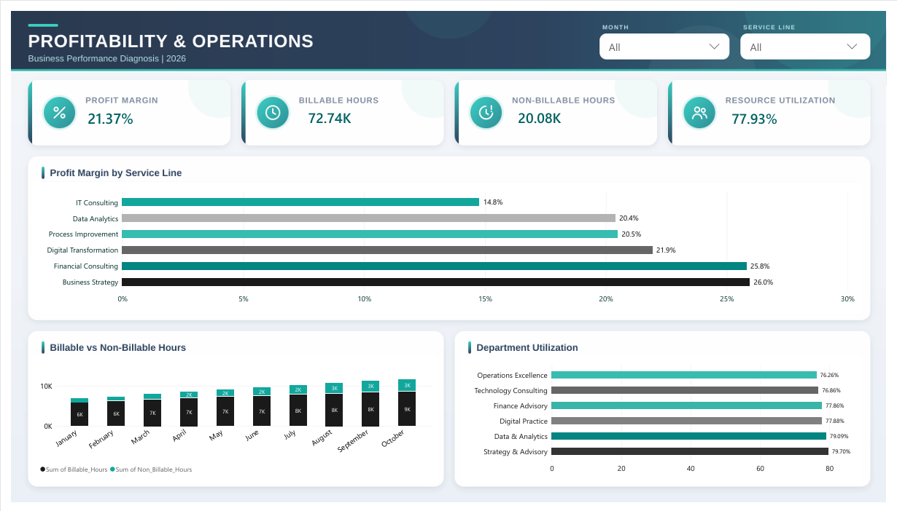
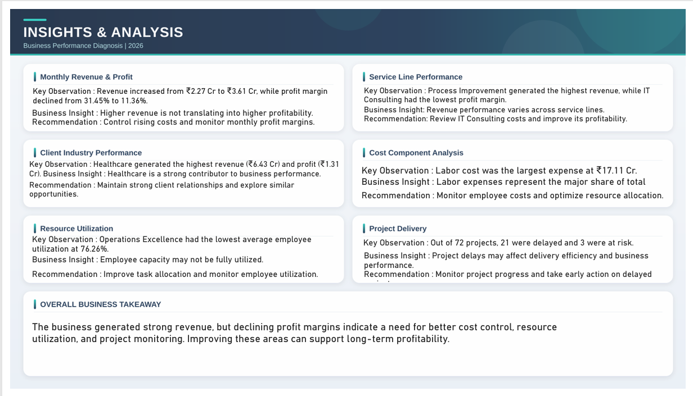

# Business Performance Diagnosis

An end-to-end data analytics project focused on identifying profitability challenges in a Consulting & Professional Services business.

## Project Overview

The business generated increasing revenue, but its profit margin declined over the January–October 2026 period. This project analyzes financial performance, service-line profitability, client-industry contribution, cost components, resource utilization, and project delivery to identify areas that require management attention.

## Business Problem

**Revenue was increasing while profit margin was declining.**

The objective was to analyze business and operational data, identify important performance patterns, and provide practical recommendations to support better business decisions.

## Tools & Technologies

* **Excel** – Data cleaning, validation, PivotTables, and initial analysis
* **MySQL** – Data querying and answering business questions
* **Python** – Data analysis using Pandas and NumPy
* **Power BI** – Interactive dashboards and business insights

## Data Source

The project uses a 2026 consulting and professional-services dataset covering January to October 2026. The analysis uses transaction-level business data and a project master table.

*Dataset source: Kaggle. Add the exact Kaggle dataset title and URL here before publishing if you are permitted to share the source link.*

## Analysis Highlights

* Analyzed revenue, cost, profit, and profit margin.
* Compared monthly revenue and profitability trends.
* Evaluated service-line and client-industry performance.
* Analyzed labor, technology, operational, and other cost components.
* Reviewed billable and non-billable hours and employee utilization.
* Examined project delivery status and delayed projects.

## Key Business Findings

| Metric / Finding                      | Result                         |
| ------------------------------------- | ------------------------------ |
| Total Revenue                         | ₹30.51 Cr                      |
| Total Cost                            | ₹23.99 Cr                      |
| Total Profit                          | ₹6.52 Cr                       |
| Overall Profit Margin                 | 21.37%                         |
| January Profit Margin                 | 31.45%                         |
| October Profit Margin                 | 11.36%                         |
| Largest Cost Component                | Labor Cost – ₹17.11 Cr         |
| Highest-Revenue Service Line          | Process Improvement            |
| Lowest-Margin Service Line            | IT Consulting                  |
| Highest-Revenue Client Industry       | Healthcare – ₹6.43 Cr          |
| Lowest Average Utilization Department | Operations Excellence – 76.26% |
| Delayed Projects                      | 21 out of 72                   |
| At-Risk Projects                      | 3 out of 72                    |

## Recommendations

* Monitor monthly costs and profit margins to understand the decline in profitability.
* Review IT Consulting delivery costs and pricing to improve its margin.
* Monitor labor expenses and improve resource allocation.
* Improve employee utilization, particularly in Operations Excellence.
* Track delayed and at-risk projects and take corrective action early.

## Power BI Dashboard

The Power BI report contains three pages:

1. **Executive Overview** – Revenue, cost, profit, margin, monthly trends, service-line performance, client-industry performance, and cost components.
2. **Profitability & Operations** – Profit margin by service line, billable and non-billable hours, and department utilization.
3. **Insights & Analysis** – Key observations, business insights, and recommendations across the analysis areas.

### Page 1 – Executive Overview

)

### Page 2 – Profitability & Operations

### Page 3 – Insights & Analysis

## Conclusion

This project demonstrates an end-to-end analytics workflow: transforming raw business data into analysis, dashboards, and actionable recommendations. The findings highlight the importance of monitoring profitability alongside revenue growth.
